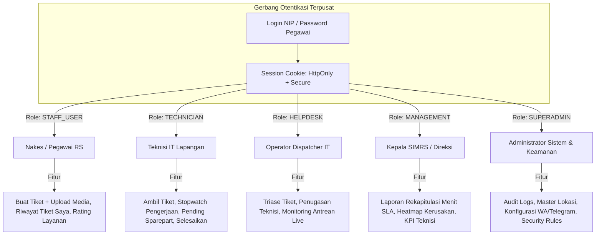
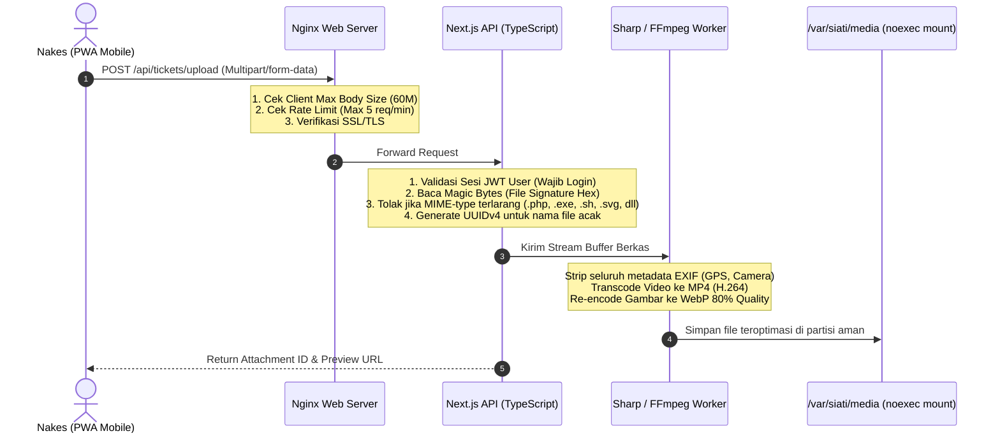
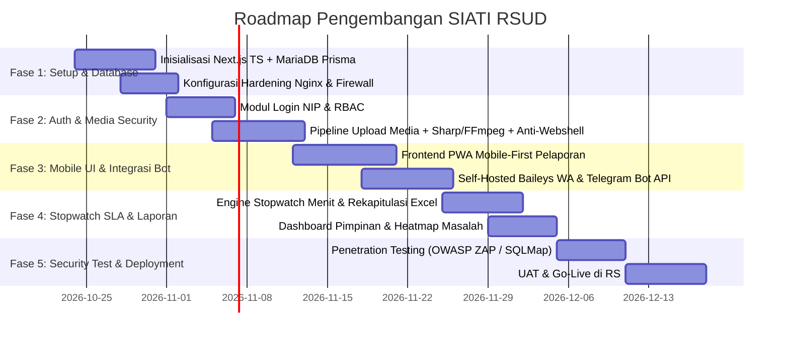

# PRODUCT REQUIREMENT DOCUMENT (PRD)
## SIATI: Sistem Informasi Aduan & Ticketing IT Rumah Sakit Pemerintah

---

| Metadata Dokumen | Spesifikasi Teknis Produk |
| :--- | :--- |
| **Nama Produk** | **SIATI** (Sistem Informasi Aduan & Ticketing IT) |
| **Instansi Sasaran** | Rumah Sakit Pemerintah (RSUD / RSUP) |
| **Versi Dokumen** | **1.1.0** *(Updated with Architectural Decisions)* |
| **Status** | **Approved & Finalized** |
| **Pola Arsitektur** | **Fullstack TypeScript (Next.js 14+ App Router + PWA)** |
| **Database & ORM** | **MariaDB 10.11+ LTS** dengan **Prisma ORM** |
| **Server & Reverse Proxy** | **Nginx** (SSL TLS 1.3, Rate Limiting, Protected Storage via `X-Accel`) |
| **Otentikasi & Akses** | **Wajib Login Pegawai** (NIP/Username, Role-Based Access Control / RBAC) |
| **Notifikasi Gateway** | **Self-Hosted WhatsApp (Baileys Engine)** & **Telegram Bot API** |

---

## 1. Executive Summary & Problem Statement

### 1.1 Latar Belakang
Rumah Sakit Pemerintah beroperasi selama **24 jam sehari, 7 hari seminggu (24/7)** dengan dinamika pelayanan kritis tinggi di Instalasi Gawat Darurat (IGD), Rawat Inap/Bangsal, Rawat Jalan/Poliklinik, Farmasi, Laboratorium, Radiologi, hingga Kasir. Kelancaran pelayanan medis sangat bergantung pada keandalan infrastruktur IT:
1. **SIMRS (Sistem Informasi Manajemen Rumah Sakit)** yang tidak boleh terputus saat bridging BPJS (V-Claim), resep elektronik, dan rekam medis digital (RME).
2. **Perangkat Keras (Hardware)** seperti PC poliklinik, monitor ICU, printer label resep obat, printer barcode gelang pasien, dan scanner barcode.
3. **Jaringan (Network)** LAN, access point WiFi medis, dan koneksi internet antar-gedung.

### 1.2 Masalah yang Diselesaikan (*Pain Points*)
* **Pelaporan Manual & Berserakan**: Aduan sering masuk melalui telepon pribadi teknisi IT, obrolan WhatsApp informal yang sering tenggelam, atau teriakan langsung ke ruang IT.
* **Kurangnya Bukti Visual Kerusakan**: Nakes kesulitan menjelaskan gejala kerusakan teknis secara teks tanpa lampiran foto atau rekaman video langsung dari lokasi (misal: bunyi beep hardware, pesan pop-up error SIMRS).
* **Akuntabilitas & SLA Kabur**: Pihak manajemen RS tidak memiliki rekapitulasi data riil berapa menit tim IT merespon dan menyelesaikan masalah. Sering terjadi silang pendapat antara nakes dan tim IT mengenai kecepatan penanganan.
* **Ketiadaan Notifikasi Real-time Lapangan**: Teknisi yang sedang berada di bangsal/lapangan sering terlambat mengetahui tiket baru yang masuk di helpdesk.
* **Kerentanan Keamanan Siber**: Rumah Sakit pemerintah menjadi sasaran empuk serangan siber (Ransomware, defacement, eksploitasi web shell dari celah upload file, SQL Injection, brute force login).

### 1.3 Sasaran Produk (*Product Goals*)
1. **Penyederhanaan Pelaporan (< 30 Detik)**: Antarmuka *Mobile-First* yang memungkinkan nakes melapor dengan cepat langsung dari smartphone ruangan, terotentikasi resmi via NIP/Akun Pegawai.
2. **Notifikasi Otomatis Dua Arah**: Integrasi mandiri WhatsApp (Self-Hosted Baileys) & Telegram Bot langsung ke grup siaga IT dan ponsel teknisi.
3. **Pelacakan SLA Menit per Kasus (MTTR Tracking)**: Pencatatan presisi stopwatch durasi penanganan (Response Time, On-Site Time, Execution Time dalam menit) sebagai dasar KPI dan transparansi kinerja.
4. **Keamanan Siber Berlapis (*Zero-Trust Media & Hardened Infrastructure*)**: Proteksi upload video/foto bebas dari malware/webshell, proteksi SQLi, XSS, rate-limiting Nginx, dan pencatatan audit log tak terhapus.

---

## 2. Aktor Sistem & Hak Akses (RBAC Model)

Seluruh staf dan nakes **wajib login** sebelum dapat menggunakan sistem.



---

## 3. Tech Stack & Arsitektur Sistem

* **Framework Inti**: **Next.js 14+ (App Router)** Fullstack TypeScript
  * Server Actions & Route Handlers untuk backend API
  * React Server Components (RSC) + Client Components Mobile-First
  * Manifest PWA (Progressive Web App) dapat di-install di layar utama smartphone nakes
* **Database & ORM**: **MariaDB 10.11+ LTS** dengan **Prisma ORM**
  * Tipe data strongly typed
  * Prepared statements otomatis anti-SQLi
  * Connection pooling terkelola
* **Web Server & Reverse Proxy**: **Nginx**
  * SSL/TLS 1.3 modern profile
  * HTTP/2
  * Rate Limiting per IP (`limit_req`)
  * Serving file upload terlindungi via `X-Accel-Redirect` (Direct access diblokir)
* **Media Processing Engine**:
  * Gambar: `Sharp` (WebP conversion, resize, pembersihan EXIF metadata)
  * Video: `FFmpeg` (Kompresi H.264/AAC, scaling 720p, durasi maks 60 detik)
* **Pemberitahuan Otomatis (Notification Engine)**:
  * **WhatsApp**: Self-Hosted Gateway berbasis **Baileys (Node.js/TypeScript microservice)** running lokal di server RS (Hemat biaya, tanpa ketergantungan pihak ketiga, nomor resmi RS).
  * **Telegram**: Telegram Bot API via Webhook SSL untuk broadcast grup IT & tombol respon interaktif.

---

## 4. Spesifikasi Fungsional Detail

### 4.1 Modul Pelaporan Tiket (Mobile-First)
1. **Otentikasi Pegawai & Proteksi Login**:
   - Login menggunakan **Username (Nama Depan Pengguna)** (contoh: `siti`, `rian`, `operator`, `admin`) atau NIP resmi pegawai dan Password.
   - **Verifikasi CAPTCHA Anti-Bot (Ketik Sesuai Gambar)**:
     - Menggunakan gambar *Alphanumeric Distorted Code* (5 karakter huruf/angka acak tanpa karakter ambigu seperti 0, O, 1, I).
     - Pengguna cukup mengetik 5 karakter yang tampak pada gambar (bersifat *case-insensitive* / huruf besar-kecil sama saja).
     - Bekerja 100% offline pada jaringan intranet RS dengan proteksi HMAC SHA-256 berkedaluwarsa 120 detik.
     - **Pre-Auth Gate**: Validasi token CAPTCHA dieksekusi sebelum proses verifikasi hash password untuk mencegah *CPU Resource Exhaustion DoS*.
   - Opsi *Remember Me* dengan secure encrypted refresh token.
   - Profil pelapor (Nama Lengkap, Unit Kerja, No. HP/WA) otomatis terisi dari basis data pegawai.
2. **Form Pelaporan Cepat**:
   - **Pemilihan Lokasi Dinamis**: Gedung -> Lantai -> Ruangan/Poli/Bangsal (Tersedia fitur Scan QR Code ruangan untuk auto-select).
   - **Kategori Masalah**:
     - *SIMRS*: Error bridging BPJS/V-Claim, error input RME, resep e-prescribing gagal cetak, akun terkunci.
     - *Hardware*: PC mati, monitor bergaris/blank, scanner barcode tidak membaca, UPS bunyi, keyboard macet.
     - *Printer*: Kertas macet (paper jam), hasil cetak bergaris, tinta habis, printer label resep tidak respon.
     - *Jaringan*: WiFi poli putus, kabel LAN terlepas, internet lambat.
     - *Fasilitas Pendukung*: Telepon internal PABX mati, bel perawat bermasalah.
   - **Skala Prioritas**:
     - 🔴 **Emergency (P1)**: Pelayanan pasien berhenti total (IGD, Kamar Operasi, Farmasi Antrean Macet). Target Respon: < 5 Menit.
     - 🟠 **High (P2)**: Layanan terhambat, unit belum punya backup. Target Respon: < 15 Menit.
     - 🟡 **Medium (P3)**: Gangguan minor, pekerjaan administratif masih bisa berjalan. Target Respon: < 30 Menit.
     - 🟢 **Low (P4)**: Permintaan instalasi baru atau perawatan berkala. Target Respon: < 60 Menit.
3. **Lampiran Foto & Video (Mobile Native-Feel)**:
   - Tombol kamera langsung: `input type="file" accept="image/*" capture="environment"`
   - Tombol video langsung: `input type="file" accept="video/*" capture="environment"`
   - Durasi video maksimal: **60 detik** (dengan kompresi preview di sisi ponsel sebelum upload).
   - Maksimal ukuran per file: Foto 10MB, Video 50MB.

---

### 4.2 Pipeline Upload Media & Pertahanan Siber Anti-Hacker



#### Aturan Keamanan Berkas:
* **Larangan Eksekusi Langsung**: Direktori penyimpanan `/var/siati/media` diletakkan di luar web root publik dan dimount dengan parameter sistem `noexec,nosuid,nodev`.
* **X-Accel-Redirect**: Pengguna tidak dapat menembak URL file secara langsung. Akses file media hanya dilayani oleh Nginx melalui internal redirection setelah backend Next.js memvalidasi hak akses tiket terkait.
* **Pembersihan Metadata (EXIF Stripping)**: Seluruh data lokasi GPS dan identifier perangkat kamera dihapus demi menjaga kerahasiaan data fasilitas kesehatan.

---

### 4.3 Integrasi Notifikasi Dua Arah: WhatsApp & Telegram

#### A. WhatsApp Gateway (Self-Hosted Baileys)
* Microservice Node.js mandiri yang terhubung ke nomor WhatsApp resmi Tim IT RS.
* **Format Notifikasi ke Teknisi**:
```text
🔔 [SIATI RSUD] TIKET MASUK BARU!
No. Tiket  : #TKT-20261023-0012
Unit       : IGD - Ruang Tindakan Bedah
Prioritas  : 🔴 EMERGENCY (P1)
Kendala    : PC Resusitasi Hang, RME Tidak Bisa Simpan
Pelapor    : dr. Hendra, Sp.B (NIP: 19850214xxxx)
Media      : 1 Foto & 1 Video Terlampir

👉 Buka & Ambil Tiket:
https://siati.rsud.go.id/teknisi/tiket/TKT-20261023-0012
```
* **Format Notifikasi ke Pelapor**:
  - Saat tiket dibuat: Konfirmasi no. tiket dan estimasi waktu penanganan.
  - Saat teknisi mengambil: *"Teknisi [Nama] sedang menuju ke [Ruangan Anda]."*
  - Saat selesai: *"Aduan telah selesai ditangani. Mohon berikan penilaian bintang 1-5 di link berikut."*

#### B. Telegram Bot (Grup Siaga IT)
* Bot mengirimkan card notifikasi ke grup Telegram "Tim IT & SIMRS".
* Dilengkapi tombol interaktif (*Inline Keyboard*):
  * `[ 🛠️ Ambil Tiket Ini ]`
  * `[ 📄 Detail & Lampiran ]`
* Saat tombol ditekan, status tiket otomatis berubah menjadi `ASSIGNED`, timer respon berhenti, dan pesan Telegram ter-update secara real-time.

---

### 4.4 Rekapitulasi Durasi Penanganan IT (Presisi Menit)

#### Metrik Waktu Kunci (Stopwatch Terotomatisasi):
1. **Waktu Respon (TTR - Time to Respond)**:
   $$\text{Durasi Respon} = \text{Waktu Tiket Diambil} - \text{Waktu Tiket Dibuat}$$
2. **Waktu Menuju Lokasi (Travel Time)**:
   $$\text{Waktu Tiba} = \text{Waktu Teknisi Tiba di Ruangan} - \text{Waktu Tiket Diambil}$$
3. **Durasi Pengerjaan Bersih (Net Resolution Time)**:
   $$\text{Durasi Kerja} = (\text{Waktu Tiket Selesai} - \text{Waktu Mulai Kerja}) - \text{Total Waktu Jeda (Pending Sparepart)}$$
4. **Total Durasi Siklus (Lead Time)**:
   Total menit dari pelaporan awal hingga masalah teratasi penuh.

#### Fitur Rekapitulasi & Reporting di Dashboard:
* **Tabel Rekapitulasi Kinerja Bulanan**:
  * Kolom: No, Nama Teknisi, Total Tiket Selesai, Rata-rata Menit Respon, Rata-rata Menit Perbaikan, Persentase Sesuai SLA (%), Skor Kepuasan.
* **Fitur Pause/Pending dengan Alasan Resmi**:
  * Jika perbaikan tertunda karena menunggu pembelian suku cadang (misal motherboard/cartridge), teknisi dapat mengaktifkan status `PENDING_SPAREPART`. Stopwatch pengerjaan akan dijeda agar tidak merusak penilaian SLA teknisi.
* **Export Data**:
  * Export rekap ke **Excel (XLSX)** lengkap dengan rincian menit untuk lampiran penilaian SKP (Sasaran Kinerja Pegawai) / TPP tenaga IT RS.
  * Export ringkasan eksekutif ke **PDF**.

---

## 5. Pertahanan Keamanan Siber (*Fortress Security Blueprint*)

| Vektor Serangan | Metode Peretas | Proteksi Ketat di SIATI |
| :--- | :--- | :--- |
| **Malicious File Upload (Webshell/RCE)** | Mengunggah script PHP backdoor (`c99.php.jpg`) untuk mengeksekusi shell server. | 1. Direct file execution dimatikan di Nginx.<br/>2. Magic Bytes checking (hanya biner JPEG/PNG/WebP/MP4 valid).<br/>3. Seluruh file direname ke UUIDv4 acak tanpa ekstensi ganda.<br/>4. File gambar di-re-encode ulang via Sharp dan video via FFmpeg.<br/>5. File hanya diakses via internal `X-Accel-Redirect`. |
| **SQL Injection (SQLi)** | Menyuntikkan `' OR 1=1 --` pada form login atau pencarian tiket. | 1. Prisma ORM menggunakan **100% Parameterized Queries**.<br/>2. Validasi input ketat dengan pustaka **Zod** di seluruh Server Actions dan Route Handlers.<br/>3. Database user MariaDB hanya diberi hak akses tabel yang dibutuhkan (*Least Privilege Principle*). |
| **Cross-Site Scripting (XSS)** | Menyisipkan `<script>stealCookie()</script>` pada deskripsi tiket. | 1. Next.js secara native melakukan sanitasi context-aware encoding.<br/>2. Sanitasi HTML deskripsi via **DOMPurify**.<br/>3. Header **Content Security Policy (CSP)** ketat di Nginx.<br/>4. Sesi disimpan di cookie `HttpOnly`, `Secure`, `SameSite=Strict`. |
| **Brute Force & Credential Stuffing** | Menebak NIP dan password staf/teknisi dengan wordlist otomatis. | 1. Rate limiting ketat di Nginx pada rute login: **5 request per menit per IP**.<br/>2. **Verifikasi CAPTCHA Wajib** (Dual Mode: Turnstile / Self-Hosted SVG Math) untuk memutus skrip otomasi/bot peretas.<br/>3. Lockout akun otomatis selama 15 menit setelah 5x gagal login berturut-turut.<br/>4. Hashing password menggunakan **Argon2id** / **Bcrypt (cost 12)**.<br/>5. Integrasi **Fail2ban** untuk memblokir IP penyerang di firewall OS. |
| **BOLA / IDOR** | Mengubah ID tiket di URL (`/tiket/101` -> `/tiket/102`) untuk mengintip data unit lain. | 1. ID tiket publik menggunakan **UUID v7** (bukan integer berurutan).<br/>2. Middleware verifikasi kepemilikan tiket: Pelapor hanya bisa melihat tiket unitnya sendiri, teknisi hanya bisa mengedit tiket yang ditugaskan. |
| **Audit Manipulation** | Oknum menghapus atau memanipulasi log riwayat penanganan tiket. | 1. Tabel `system_audit_logs` dan `ticket_timeline_logs` bersifat **Append-Only** (hanya ada hak `INSERT`, tidak ada `UPDATE` atau `DELETE` untuk role non-DBA). |

---

## 6. Desain Skema MariaDB & Relasi Data (Prisma)

```prisma
// Cuplikan Skema Prisma untuk SIATI
datasource db {
  provider = "mysql" // MariaDB 10.11+
  url      = env("DATABASE_URL")
}

generator client {
  provider = "prisma-client-js"
}

enum Role {
  SUPERADMIN
  MANAGEMENT
  HELPDESK
  TECHNICIAN
  STAFF_USER
}

enum TicketUrgency {
  EMERGENCY // P1 (< 5 min)
  HIGH      // P2 (< 15 min)
  MEDIUM    // P3 (< 30 min)
  LOW       // P4 (< 60 min)
}

enum TicketStatus {
  SUBMITTED
  ASSIGNED
  IN_PROGRESS
  PENDING_PARTS
  RESOLVED
  CLOSED
  REJECTED
}

enum AttachmentType {
  IMAGE
  VIDEO
}

model User {
  id              String        @id @default(uuid())
  nip             String        @unique
  fullName        String
  phoneNumber     String
  telegramChatId  String?
  role            Role          @default(STAFF_USER)
  passwordHash    String
  departmentUnitId Int
  departmentUnit  DepartmentUnit @relation(fields: [departmentUnitId], references: [id])
  assignedTickets Ticket[]      @relation("TechnicianAssigned")
  createdTickets  Ticket[]      @relation("ReporterUser")
  auditLogs       SystemAuditLog[]
  createdAt       DateTime      @default(now())
  updatedAt       DateTime      @updatedAt

  @@index([nip])
  @@index([role])
}

model DepartmentUnit {
  id              Int      @id @autoincrement()
  name            String   // Contoh: IGD, Poliklinik Penyakit Dalam, Rawat Inap Melati
  buildingZone    String   // Contoh: Gedung Teratai Lt. 2
  qrIdentifier    String   @unique @default(uuid())
  users           User[]
  tickets         Ticket[]
}

model Category {
  id                 Int      @id @autoincrement()
  name               String   // Hardware, Jaringan, SIMRS, Printer
  description        String?
  targetSlaMinutes   Int      @default(30)
  tickets            Ticket[]
}

model Ticket {
  id                       String               @id @default(uuid())
  ticketNumber             String               @unique // TKT-YYYYMMDD-XXXX
  reporterId               String
  reporter                 User                 @relation("ReporterUser", fields: [reporterId], references: [id])
  unitId                   Int
  unit                     DepartmentUnit       @relation(fields: [unitId], references: [id])
  categoryId               Int
  category                 Category             @relation(fields: [categoryId], references: [id])
  urgency                  TicketUrgency        @default(MEDIUM)
  status                   TicketStatus         @default(SUBMITTED)
  description              String               @db.Text
  assignedTechnicianId     String?
  assignedTechnician       User?                @relation("TechnicianAssigned", fields: [assignedTechnicianId], references: [id])
  
  // Metrik Waktu SLA (Dalam Menit)
  submittedAt              DateTime             @default(now())
  firstAssignedAt          DateTime?
  workStartedAt            DateTime?
  workResolvedAt           DateTime?
  totalPendingMinutes      Int                  @default(0)
  responseMinutes          Int?                 // submittedAt -> firstAssignedAt
  repairMinutes            Int?                 // workStartedAt -> workResolvedAt (dikurangi pending)
  totalLeadMinutes         Int?                 // submittedAt -> workResolvedAt

  attachments              TicketAttachment[]
  timelineLogs             TicketTimelineLog[]
  rating                   TicketRating?

  @@index([status])
  @@index([urgency])
  @@index([submittedAt])
}

model TicketAttachment {
  id             String         @id @default(uuid())
  ticketId       String
  ticket         Ticket         @relation(fields: [ticketId], references: [id], onDelete: Cascade)
  fileType       AttachmentType
  originalName   String
  storedFilename String         // UUIDv4.ext
  filePath       String
  fileSizeBytes  Int
  mimeType       String
  sha256Hash     String
  durationSeconds Int?          // Khusus video
  createdAt      DateTime       @default(now())
}

model TicketTimelineLog {
  id             BigInt         @id @default(autoincrement())
  ticketId       String
  ticket         Ticket         @relation(fields: [ticketId], references: [id], onDelete: Cascade)
  actorUserId    String
  actorName      String
  previousStatus TicketStatus?
  newStatus      TicketStatus
  notes          String?        @db.Text
  createdAt      DateTime       @default(now())
}

model TicketRating {
  id             String         @id @default(uuid())
  ticketId       String         @unique
  ticket         Ticket         @relation(fields: [ticketId], references: [id], onDelete: Cascade)
  ratingScore    Int            // 1 to 5
  feedback       String?        @db.Text
  createdAt      DateTime       @default(now())
}

model SystemAuditLog {
  id             BigInt         @id @default(autoincrement())
  userId         String?
  user           User?          @relation(fields: [userId], references: [id])
  action         String
  ipAddress      String
  userAgent      String
  payload        Json?
  createdAt      DateTime       @default(now())

  @@index([createdAt])
  @@index([action])
}
```

---

## 7. Desain Antarmuka Mobile-First (User Interface Flow)

### 7.1 Alur Layar Pelapor (Staf Medis / Nakes di Ruangan)
1. **Layar Login Cepat & Aman**:
   - Field Input: NIP Pegawai & Password.
   - **Widget CAPTCHA Interaktif**:
     - *Online*: Cloudflare Turnstile box "Verify you are human" (1-klik instan).
     - *Offline/Intranet*: Gambar SVG Soal Matematika Dinamis (misal: `7 + 5 = [ ? ]`) dengan tombol refresh soal.
   - Tombol "Ingat Saya di Perangkat Ini" + Tombol Utama `[ 🔐 Masuk Akun Pegawai ]`.
2. **Beranda / Quick Action**:
   - Header: Identitas Nakes (e.g., *Ns. Siti Rahma - Bangsal Mawar*).
   - Tombol Cepat: `[ 📷 Scan QR Ruangan / Buat Laporan Baru ]` (Aksen warna kontras tinggi).
   - Kartu Status Aduan Aktif: Status real-time (*Menunggu IT*, *Teknisi Sedang Menuju Lokasi*, dll).
3. **Layar Form Lapor (Single-Page Form Optimized)**:
   - *Lokasi & Unit Kerja*: Terisi otomatis dari akun atau scan QR code di meja poli.
   - *Pilihan Kategori*: Tombol ikon besar (SIMRS, Printer, PC/Hardware, Jaringan).
   - *Tingkat Urgensi*: Chip interaktif (Darurat, Tinggi, Sedang, Rendah).
   - *Area Upload Lampiran*:
     - Tombol 1: `[ 📸 Jepret Foto Bukti ]`
     - Tombol 2: `[ 🎥 Rekam Video Masalah (Max 60d) ]`
     - Thumbnail preview dengan tombol hapus/ganti.
   - *Deskripsi Masalah*: Text area dengan opsi voice-to-text bawaan smartphone.
   - *Tombol Submit Sticky*: Selalu terlihat di bagian bawah layar (*thumb zone*).

### 7.2 Alur Layar Teknisi IT Lapangan
1. **Daftar Tugas Aktif (Work Orders)**:
   - Filter tab: `Tiket Baru (Belum Diambil)`, `Sedang Saya Tangani`, `Selesai Hari Ini`.
   - Kartu tiket mencantumkan: Urgensi (P1/P2/P3), Nama Ruangan, Menit Berjalan (Stopwatch aktif).
2. **Halaman Penanganan Tiket**:
   - Tampilan foto & video error langsung dapat diputar di browser.
   - Tombol Aksi 1-Klik:
     - `[ 🏃 Mulai Menuju Lokasi ]`
     - `[ ⚙️ Mulai Pengerjaan ]`
     - `[ ⏸️ Jeda (Tunggu Sparepart) ]`
     - `[ ✅ Selesai Diperbaiki ]` (Disertai input catatan tindakan teknisi).

---

## 8. Jadwal Rencana Kerja & Roadmap Pengembangan



---

## 9. Kesimpulan & Langkah Selanjutnya

Dokumen PRD ini telah disesuaikan sepenuhnya dengan kebutuhan operasional Rumah Sakit Pemerintah:
* **Kecepatan**: UI Mobile-First yang efisien bagi nakes di tengah padatnya pelayanan pasien.
* **Transparansi**: Penghitungan waktu respon dan resolusi otomatis dalam hitungan menit untuk KPI objektif tim IT.
* **Keamanan Maksimal**: Standar keamanan data kesehatan, anti-malware upload pipeline, dan server hardening Nginx anti-hacker.
* **Efisiensi Anggaran**: Memanfaatkan stack open-source TypeScript, MariaDB, dan Self-Hosted WhatsApp Baileys tanpa biaya langganan gateway bulanan.
